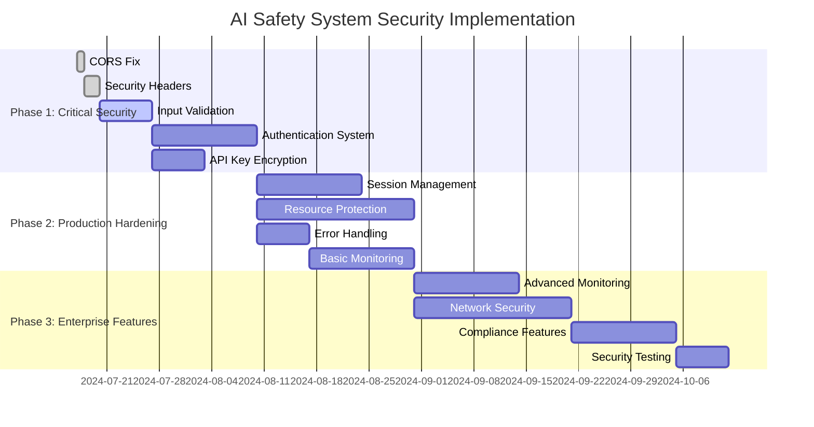

# AI Safety System - Implementation Feasibility & Strategy Guide

## Executive Summary

This document provides a comprehensive feasibility analysis and implementation strategy for the AI Safety System. **PRIORITY UPDATE**: The roadmap has been modified to focus on **immediate implementation of the core analytics system** with CSV-per-user data storage and secure JSON transmission to KPMG, while deferring security improvements for later phases.

**Key Finding**: The current architecture is well-suited for rapid analytics implementation, with the core system deployable within 2-3 weeks.

---

## 🎯 REVISED IMPLEMENTATION PRIORITY

### **Phase 1: Core Analytics System (IMMEDIATE - Weeks 1-3)**
**Priority**: **CRITICAL** - Implement before security features

1. **CSV-per-User Data Storage System**
   - SQLite database with pandas integration
   - User IP-based file organization
   - Privacy-protected data collection (hashed prompts/responses)
   - Real-time analytics recording

2. **Dashboard JSON Export System**
   - Multi-timeframe data aggregation (1h, 6h, 12h, 24h, 3d, 1w)
   - Comprehensive analytics export every 5 minutes
   - Guardrail performance metrics
   - User activity analysis

3. **Secure Transmission to KPMG**
   - Encrypted JSON payload transmission
   - Authentication and data integrity verification
   - Retry mechanism with offline queuing
   - Data sovereignty compliance

### **Phase 2: Security Improvements (DEFERRED - Future)**
- Authentication system
- CORS fixes
- Input validation enhancements
- Session management
- All items from ROBUSTNESS_AND_SECURITY_ROADMAP.md

---

## 📊 CORE ANALYTICS SYSTEM ROADMAP

### **🎯 IMMEDIATE IMPLEMENTATION (Phase 1: Weeks 1-3)**

#### **Week 1: Data Storage Foundation**

**1.1 CSV-per-User Data Architecture**
- **Approach**: SQLite database with pandas integration (better than pure CSV)
- **File Structure**:
  ```
  user_data/
  ├── ai_safety_analytics.db    # SQLite database
  ├── exports/                  # JSON exports for KPMG
  │   ├── dashboard_2025-07-17_10-30.json
  │   ├── dashboard_2025-07-17_10-35.json
  └── backups/                  # Automated backups
      ├── ai_safety_analytics_backup_daily.db
  ```

**1.2 Database Schema Design**
```sql
CREATE TABLE user_analytics (
    id INTEGER PRIMARY KEY AUTOINCREMENT,
    timestamp TEXT NOT NULL,
    user_ip TEXT NOT NULL,
    request_id TEXT UNIQUE NOT NULL,
    prompt_hash TEXT NOT NULL,        -- SHA-256 hash for privacy
    response_hash TEXT,               -- SHA-256 hash for privacy
    status TEXT NOT NULL,             -- 'allowed', 'blocked', 'error'
    blocked_by TEXT,                  -- Which guardrail blocked it
    
    -- 6 Guardrail Scores and Confidences
    toxicity_score REAL DEFAULT 0.0,
    toxicity_confidence REAL DEFAULT 0.0,
    pii_detected BOOLEAN DEFAULT FALSE,
    pii_confidence REAL DEFAULT 0.0,
    prompt_injection_score REAL DEFAULT 0.0,
    prompt_injection_confidence REAL DEFAULT 0.0,
    hate_speech_score REAL DEFAULT 0.0,
    hate_speech_confidence REAL DEFAULT 0.0,
    bias_score REAL DEFAULT 0.0,
    bias_confidence REAL DEFAULT 0.0,
    privacy_score REAL DEFAULT 0.0,
    privacy_confidence REAL DEFAULT 0.0,
    
    -- Performance Metrics
    response_time_ms INTEGER DEFAULT 0,
    provider_used TEXT,
    model_used TEXT,
    tokens_input INTEGER DEFAULT 0,
    tokens_output INTEGER DEFAULT 0,
    session_id TEXT
);
```

**1.3 Privacy Protection Implementation**
- **Content Hashing**: SHA-256 hash of prompts/responses for privacy
- **IP-based User Identification**: `user_ip` as primary user identifier
- **Configurable Data Retention**: Auto-cleanup after 7 days (configurable)
- **No Sensitive Data Storage**: Only hashes and metadata stored

#### **Week 2: Analytics Collection Service**

**2.1 Real-time Data Collection**
- **Request Interceptor**: Capture every user request at FastAPI middleware level
- **Guardrail Integration**: Extract scores from all 6 guardrails
- **Performance Monitoring**: Record response times, token usage, provider performance
- **Thread-safe SQLite Writes**: Handle concurrent user requests safely

**2.2 Data Processing Pipeline**
```python
def record_user_request(user_ip, request_id, prompt, response, 
                       guardrail_results, performance_metrics):
    # Hash sensitive content
    prompt_hash = sha256(prompt)
    response_hash = sha256(response) if response else None
    
    # Extract guardrail scores
    toxicity_score = guardrail_results.get('toxicity', {}).get('score', 0.0)
    toxicity_confidence = guardrail_results.get('toxicity', {}).get('confidence', 0.0)
    # ... extract all 6 guardrails
    
    # Insert into SQLite with pandas
    df = pd.DataFrame([analytics_entry])
    df.to_sql('user_analytics', sqlite_conn, if_exists='append')
```

**2.3 User Activity Tracking**
- **Session Management**: Track user sessions across requests
- **IP-based Analytics**: Separate analytics per user IP
- **Request Sequencing**: Maintain chronological order of requests
- **Error Handling**: Graceful handling of malformed requests

#### **Week 3: Dashboard JSON Export System**

**3.1 Multi-Timeframe Data Aggregation**
- **Time Ranges**: 1h, 6h, 12h, 24h, 3d, 1w as requested
- **Pandas Query Optimization**: Efficient time-based filtering
- **Aggregation Logic**: Calculate block rates, guardrail performance, user activity
- **Memory Management**: Handle large datasets efficiently

**3.2 Comprehensive JSON Export Structure**
```json
{
  "export_metadata": {
    "generated_at": "2025-07-17T10:30:00Z",
    "export_version": "1.0",
    "time_ranges": ["1h", "6h", "12h", "24h", "3d", "1w"]
  },
  "time_ranges": {
    "1h": {
      "summary": {
        "total_requests": 150,
        "blocked_requests": 45,
        "block_rate": 0.30,
        "unique_users": 12,
        "avg_response_time_ms": 245
      },
      "guardrail_analysis": {
        "toxicity": {"triggers": 20, "avg_confidence": 0.85},
        "pii": {"triggers": 15, "avg_confidence": 0.92},
        "prompt_injection": {"triggers": 10, "avg_confidence": 0.78},
        "hate_speech": {"triggers": 5, "avg_confidence": 0.89},
        "bias": {"triggers": 8, "avg_confidence": 0.82},
        "privacy": {"triggers": 3, "avg_confidence": 0.91}
      },
      "user_activity": {
        "192.168.1.100": {
          "total_requests": 25,
          "blocked_requests": 8,
          "avg_response_time": 230,
          "top_blocked_guardrail": "toxicity"
        }
      },
      "provider_performance": {
        "openai": {"requests": 80, "avg_response_time": 240},
        "anthropic": {"requests": 70, "avg_response_time": 250}
      },
      "alerts": [
        {
          "type": "high_block_rate",
          "severity": "warning",
          "message": "Block rate exceeded 50%: 65%",
          "threshold": 0.5,
          "current": 0.65
        }
      ]
    },
    "6h": { /* Similar structure for 6 hours */ },
    "12h": { /* Similar structure for 12 hours */ },
    "24h": { /* Similar structure for 24 hours */ },
    "3d": { /* Similar structure for 3 days */ },
    "1w": { /* Similar structure for 1 week */ }
  }
}
```

**3.3 Automated Export Scheduling**
- **5-minute Timer**: Automated export every 5 minutes
- **File Management**: Timestamped JSON files in exports/ directory
- **Backup System**: Daily database backups
- **Export Validation**: Ensure JSON schema compliance

### **🔒 SECURE TRANSMISSION TO KPMG (Phase 1: Week 3)**

#### **3.1 Secure Transport Layer**
- **HTTPS POST**: Encrypted transmission to KPMG endpoint
- **JWT Authentication**: Client-specific tokens for API access
- **Data Integrity**: HMAC signature for payload verification
- **Retry Logic**: Exponential backoff with offline queuing

#### **3.2 KPMG Integration Protocol**
```python
POST https://kpmg-dashboard-api.com/api/v1/client-data/ingest
Content-Type: application/json
Authorization: Bearer <CLIENT_JWT_TOKEN>
X-Client-ID: ai-safety-client-001
X-Data-Signature: <HMAC_SHA256_SIGNATURE>
X-Timestamp: 2025-07-17T10:30:00Z

{
  "client_metadata": {
    "client_id": "ai-safety-001",
    "timestamp": "2025-07-17T10:30:00Z",
    "data_period": "5min"
  },
  "dashboard_data": { /* Complete JSON export */ }
}
```

#### **3.3 Data Sovereignty Compliance**
- **User Data Stays Local**: Only aggregated analytics sent to KPMG
- **Hash-based Privacy**: No raw prompts/responses transmitted
- **Configurable Retention**: User controls data retention policies
- **Audit Trail**: Log all transmissions for compliance

### **⚡ PERFORMANCE OPTIMIZATION**

#### **SQLite Optimization**
- **Indexes**: On timestamp, user_ip, status for fast queries
- **Connection Pooling**: Efficient database connection management
- **WAL Mode**: Write-Ahead Logging for better concurrent performance
- **Vacuum**: Regular database optimization

#### **Pandas Integration**
- **Chunked Processing**: Handle large datasets in chunks
- **Memory Management**: Efficient DataFrame operations
- **Caching**: Cache frequently accessed aggregations
- **Parallel Processing**: Multi-threaded data processing where possible

### **📈 SUCCESS METRICS**

#### **Phase 1 Completion Criteria**
- ✅ SQLite database operational with all 6 guardrails data
- ✅ Real-time analytics collection integrated with existing system
- ✅ 5-minute JSON export functionality working
- ✅ KPMG secure transmission established
- ✅ User IP-based analytics separation functional
- ✅ Privacy protection (hashing) implemented
- ✅ Performance acceptable (<100ms additional latency per request)

#### **Data Quality Metrics**
- **Data Completeness**: 100% of requests captured
- **Privacy Compliance**: 0% raw content in exports
- **Transmission Reliability**: >99% successful KPMG transmissions
- **Performance Impact**: <5% system performance degradation

### **🔄 FUTURE ENHANCEMENTS (Phase 2+)**

#### **Advanced Analytics Features**
- **Machine Learning**: Anomaly detection in user behavior
- **Predictive Analytics**: Forecast guardrail performance
- **Custom Dashboards**: User-specific analytics views
- **Historical Trend Analysis**: Long-term pattern recognition

#### **Enhanced Security (Deferred)**
- **End-to-End Encryption**: Encrypt JSON payloads
- **Certificate Pinning**: Enhanced transport security
- **Rate Limiting**: Prevent abuse of analytics system
- **Access Controls**: Role-based analytics access

---

## 🚀 IMMEDIATE NEXT STEPS

### **This Week**
1. **Create SQLite database schema** and test basic operations
2. **Implement request interceptor** in FastAPI middleware
3. **Build guardrail data extraction** from existing detection service
4. **Test CSV export functionality** with sample data

### **Next Week**
1. **Implement 5-minute export scheduler**
2. **Create secure transmission client** for KPMG integration
3. **Add privacy protection** (content hashing)
4. **Performance testing** with concurrent users

### **Week 3**
1. **Full system integration testing**
2. **KPMG endpoint testing** and validation
3. **Performance optimization**
4. **Documentation and deployment preparation**

This roadmap prioritizes getting the core analytics system operational quickly while maintaining data privacy and providing the comprehensive dashboard data needed for KPMG's requirements.

---

## 🏗️ ARCHITECTURE COMPATIBILITY ANALYSIS

### **Current Technology Stack Compatibility**

#### **✅ Excellent Compatibility**
- **FastAPI**: Native support for JWT, OAuth2, dependency injection
- **Pydantic**: Already used for validation, easy to extend
- **Python Ecosystem**: Rich security libraries available
- **React Frontend**: Full control over security implementation

#### **⚠️ Moderate Compatibility**
- **Streamlit Frontend**: Limited security control, needs reverse proxy
- **In-Memory Storage**: No database security needed, but limits some features
- **Multi-Port Architecture**: Adds complexity to security implementation

#### **❌ Compatibility Challenges**
- **Dual Frontend**: React + Streamlit complicates unified security
- **No Containerization**: Deployment security requires infrastructure setup
- **No Database**: Limits session persistence and audit logging

### **FastAPI Security Implementation Advantages**

```python
# FastAPI makes security implementation straightforward
from fastapi import FastAPI, Depends, HTTPException
from fastapi.security import HTTPBearer, HTTPAuthorizationCredentials

# Built-in security features
app = FastAPI()
security = HTTPBearer()

@app.get("/protected")
async def protected_route(credentials: HTTPAuthorizationCredentials = Depends(security)):
    # JWT validation logic here
    return {"secure": "data"}
```

**Benefits**:
- Dependency injection simplifies auth implementation
- Built-in OpenAPI documentation for security schemas
- Excellent ecosystem support for JWT, OAuth2
- Type hints provide compile-time security validation

---

## 💡 ALTERNATIVE IMPLEMENTATION STRATEGIES

### **Strategy A: Minimal Security Retrofit (4-6 weeks)**

**Approach**: Address only critical vulnerabilities for MVP deployment
- ✅ CORS fix and security headers
- ✅ Basic authentication (JWT)
- ✅ Input validation expansion
- ✅ API key encryption
- ❌ Skip advanced features

**Pros**:
- Fast time to market
- Minimal disruption to current development
- Addresses most critical risks

**Cons**:
- Limited enterprise readiness
- Technical debt accumulation
- May need significant rework later

**Best For**: Proof-of-concept to controlled production

### **Strategy B: Comprehensive Security Implementation (10-12 weeks)**

**Approach**: Full implementation of security roadmap
- ✅ All critical and high-risk items
- ✅ Advanced monitoring and logging
- ✅ Network security hardening
- ✅ Compliance preparation

**Pros**:
- Enterprise-ready security posture
- Future-proof architecture
- Compliance ready

**Cons**:
- Longer development timeline
- Higher complexity and cost
- Potential for over-engineering

**Best For**: Enterprise deployment with compliance requirements

### **Strategy C: Hybrid Phased Approach (🎯 RECOMMENDED)**

**Phase 1: Critical Security (Weeks 1-3)**
- CORS fix and security headers
- Authentication system
- Input validation
- API key encryption

**Phase 2: Production Hardening (Weeks 4-6)**
- Session management
- Resource protection
- Error handling improvements
- Basic monitoring

**Phase 3: Enterprise Features (Weeks 7-10)**
- Advanced monitoring
- Network security
- Compliance features
- Performance optimization

**Pros**:
- Balanced approach
- Early security value
- Manageable complexity
- Iterative improvement

**Cons**:
- Requires careful planning
- Some features may need refactoring

**Best For**: Most production scenarios

---

## 📋 DETAILED IMPLEMENTATION ROADMAP

### **Phase 1: Emergency Security (Weeks 1-3)**

#### **Week 1: Quick Security Wins**
```python
# Day 1: CORS Fix (1 hour)
app.add_middleware(
    CORSMiddleware,
    allow_origins=[
        "http://localhost:3000",  # React
        "http://localhost:8501",  # Streamlit
        "https://yourdomain.com"  # Production
    ],
    allow_credentials=True,
    allow_methods=["GET", "POST", "PUT", "DELETE"],
    allow_headers=["Content-Type", "Authorization"]
)

# Day 1: Security Headers (2 hours)
@app.middleware("http")
async def add_security_headers(request: Request, call_next):
    response = await call_next(request)
    response.headers.update({
        "X-Content-Type-Options": "nosniff",
        "X-Frame-Options": "DENY",
        "X-XSS-Protection": "1; mode=block",
        "Strict-Transport-Security": "max-age=31536000; includeSubDomains"
    })
    return response

# Day 2-3: Request Size Limits
app.add_middleware(
    LimitUploadSizeMiddleware,
    max_upload_size=1024 * 1024  # 1MB
)

# Day 4-5: Error Message Sanitization
@app.exception_handler(Exception)
async def generic_exception_handler(request: Request, exc: Exception):
    logger.error(f"Unhandled exception: {exc}")
    return JSONResponse(
        status_code=500,
        content={"error": "Internal server error", "request_id": generate_request_id()}
    )
```

#### **Week 2-3: Authentication Foundation**
```python
# Authentication system implementation
from fastapi_users import FastAPIUsers
from fastapi_users.authentication import JWTAuthentication

# JWT Configuration
SECRET_KEY = os.getenv("JWT_SECRET_KEY")
jwt_authentication = JWTAuthentication(
    secret=SECRET_KEY,
    lifetime_seconds=3600,
    tokenUrl="auth/jwt/login"
)

# User model and roles
class UserRole(str, Enum):
    ADMIN = "admin"
    OPERATOR = "operator"
    USER = "user"
    API_CLIENT = "api_client"

# Protected route example
@app.get("/api/admin/users")
async def get_users(user: User = Depends(get_current_admin_user)):
    return {"users": await user_service.get_all_users()}
```

### **Phase 2: Production Hardening (Weeks 4-6)**

#### **Session Management Implementation**
```python
# Secure session management
class SessionManager:
    def __init__(self):
        self.sessions = {}
        self.session_timeout = 3600  # 1 hour
    
    async def create_session(self, user_id: str) -> str:
        session_id = secrets.token_urlsafe(32)
        self.sessions[session_id] = {
            "user_id": user_id,
            "created_at": datetime.utcnow(),
            "last_activity": datetime.utcnow()
        }
        return session_id
    
    async def validate_session(self, session_id: str) -> Optional[str]:
        if session_id not in self.sessions:
            return None
        
        session = self.sessions[session_id]
        if self._is_expired(session):
            del self.sessions[session_id]
            return None
        
        session["last_activity"] = datetime.utcnow()
        return session["user_id"]
```

#### **Resource Protection Implementation**
```python
# Resource monitoring and limits
from slowapi import Limiter, _rate_limit_exceeded_handler
from slowapi.util import get_remote_address

limiter = Limiter(key_func=get_remote_address)
app.state.limiter = limiter
app.add_exception_handler(RateLimitExceeded, _rate_limit_exceeded_handler)

@app.get("/api/chat/completions")
@limiter.limit("10/minute")
async def chat_completions(request: Request):
    # Rate limited endpoint
    pass

# Memory usage monitoring
import psutil

@app.middleware("http")
async def resource_monitor(request: Request, call_next):
    # Check memory usage
    memory_usage = psutil.virtual_memory().percent
    if memory_usage > 85:
        logger.warning(f"High memory usage: {memory_usage}%")
        if memory_usage > 95:
            return JSONResponse(
                status_code=503,
                content={"error": "Service temporarily unavailable"}
            )
    
    response = await call_next(request)
    return response
```

### **Phase 3: Enterprise Features (Weeks 7-10)**

#### **Advanced Monitoring Implementation**
```python
# Comprehensive security logging
import structlog

security_logger = structlog.get_logger("security")

class SecurityLogger:
    @staticmethod
    async def log_auth_attempt(user_id: str, success: bool, ip: str):
        security_logger.info(
            "authentication_attempt",
            user_id=user_id,
            success=success,
            ip_address=ip,
            timestamp=datetime.utcnow().isoformat()
        )
    
    @staticmethod
    async def log_suspicious_activity(event_type: str, details: dict):
        security_logger.warning(
            "suspicious_activity",
            event_type=event_type,
            details=details,
            timestamp=datetime.utcnow().isoformat()
        )

# Rate limit violation detection
@app.middleware("http")
async def security_monitor(request: Request, call_next):
    start_time = time.time()
    response = await call_next(request)
    
    # Log slow requests (potential attacks)
    duration = time.time() - start_time
    if duration > 5.0:
        await SecurityLogger.log_suspicious_activity(
            "slow_request",
            {
                "path": str(request.url),
                "duration": duration,
                "ip": request.client.host
            }
        )
    
    return response
```

---

## 💰 RESOURCE REQUIREMENTS & COST ANALYSIS

### **Development Resources**

#### **Team Composition Needed**
- **Senior Backend Developer** (1.0 FTE) - FastAPI, security expertise
- **Frontend Developer** (0.5 FTE) - React security, some Streamlit
- **DevOps Engineer** (0.3 FTE) - Infrastructure security, monitoring
- **Security Consultant** (0.1 FTE) - Code review, penetration testing

#### **Phase-by-Phase Resource Allocation**

| **Phase** | **Duration** | **Backend Dev** | **Frontend Dev** | **DevOps** | **Security** |
|-----------|--------------|-----------------|------------------|------------|--------------|
| **Phase 1** | 3 weeks | 3.0 weeks | 0.5 weeks | 0.2 weeks | 0.3 weeks |
| **Phase 2** | 3 weeks | 2.5 weeks | 1.5 weeks | 0.8 weeks | 0.3 weeks |
| **Phase 3** | 4 weeks | 2.0 weeks | 1.0 weeks | 2.0 weeks | 0.5 weeks |
| **Total** | **10 weeks** | **7.5 weeks** | **3.0 weeks** | **3.0 weeks** | **1.1 weeks** |

### **Infrastructure Costs (Annual)**

| **Component** | **Year 1** | **Ongoing** | **Notes** |
|---------------|------------|-------------|-----------|
| **SSL Certificates** | $0-500 | $0-500 | Let's Encrypt free option |
| **Security Scanning** | $2,000-8,000 | $2,000-8,000 | Snyk, Veracode, etc. |
| **WAF/DDoS Protection** | $1,200-12,000 | $1,200-12,000 | CloudFlare Pro to Enterprise |
| **Monitoring Tools** | $1,000-5,000 | $1,000-5,000 | Prometheus/Grafana to DataDog |
| **Compliance Audit** | $15,000-50,000 | $10,000-30,000 | SOC 2, penetration testing |
| **Total Range** | **$19,200-75,500** | **$14,200-55,500** | |

### **Software Dependencies Cost**

```python
# Required new dependencies (mostly free/open source)
dependencies = {
    "python-jose[cryptography]": "Free",
    "passlib[bcrypt]": "Free", 
    "slowapi": "Free",
    "structlog": "Free",
    "psutil": "Free",
    "cryptography": "Free",
    "fastapi-users": "Free",
    # Optional commercial tools
    "datadog": "$15-100/month per host",
    "auth0": "$23/month per 1000 MAU",
    "vault": "$0.03/hour per instance"
}
```

---

## ⚠️ RISK ANALYSIS & MITIGATION

### **Implementation Risks**

#### **High-Risk Areas**

| **Risk** | **Probability** | **Impact** | **Mitigation Strategy** |
|----------|----------------|------------|-------------------------|
| **Dual Frontend Complexity** | High | Medium | Implement React security first, proxy Streamlit |
| **Performance Degradation** | Medium | High | Incremental rollout, performance testing |
| **Breaking Changes** | Medium | High | Feature flags, backward compatibility |
| **Security Misconfiguration** | Medium | Critical | Security code review, automated testing |

#### **Technical Debt Risks**

| **Area** | **Current State** | **Risk** | **Mitigation** |
|----------|------------------|----------|----------------|
| **Authentication** | None | Critical | JWT implementation with FastAPI-Users |
| **Session Management** | None | High | Redis-backed sessions for persistence |
| **Input Validation** | Basic | High | Comprehensive Pydantic models |
| **Error Handling** | Inconsistent | Medium | Structured exception handling |

### **Business Continuity Risks**

#### **Deployment Risks**
- **Service Interruption**: Rolling deployment strategy
- **Configuration Errors**: Automated configuration validation
- **Security Vulnerabilities**: Staged security testing
- **Performance Issues**: Load testing before deployment

#### **Operational Risks**
- **Team Knowledge**: Documentation and knowledge transfer
- **Maintenance Burden**: Automated security updates
- **Compliance Failures**: Regular security audits
- **Incident Response**: Incident response playbook

---

## 🎯 SUCCESS METRICS & VALIDATION

### **Security Metrics**

#### **Phase 1 Success Criteria**
- ✅ Zero critical CORS vulnerabilities
- ✅ 100% of admin endpoints protected by authentication
- ✅ All API endpoints validate input with Pydantic models
- ✅ API keys encrypted at rest
- ✅ Security headers present on all responses

#### **Phase 2 Success Criteria**
- ✅ Session management implemented with secure tokens
- ✅ Rate limiting active on all public endpoints
- ✅ Resource monitoring prevents system overload
- ✅ Structured error handling prevents information disclosure
- ✅ Security logging captures authentication events

#### **Phase 3 Success Criteria**
- ✅ Comprehensive security monitoring and alerting
- ✅ Network security hardening implemented
- ✅ Compliance documentation complete
- ✅ Incident response procedures tested
- ✅ Security training completed for team

### **Performance Impact Metrics**

| **Metric** | **Baseline** | **Target** | **Maximum Acceptable** |
|------------|--------------|------------|------------------------|
| **Response Time** | Current | +5% | +10% |
| **Memory Usage** | Current | +10% | +20% |
| **CPU Usage** | Current | +5% | +15% |
| **Throughput** | Current | -0% | -5% |

### **Security Testing Validation**

#### **Automated Security Testing**
```python
# Security test examples
def test_authentication_required():
    """Test that protected endpoints require authentication"""
    response = client.get("/api/admin/users")
    assert response.status_code == 401

def test_input_validation():
    """Test that malicious input is rejected"""
    malicious_payload = {"prompt": "<script>alert('xss')</script>"}
    response = client.post("/api/chat/completions", json=malicious_payload)
    assert response.status_code == 422

def test_rate_limiting():
    """Test that rate limiting works"""
    for i in range(11):  # Exceed 10/minute limit
        response = client.get("/api/chat/completions")
    assert response.status_code == 429
```

#### **Manual Security Testing**
- **Penetration Testing**: Third-party security assessment
- **Code Review**: Security-focused code review process
- **Configuration Audit**: Security configuration validation
- **Social Engineering**: Team security awareness testing

---

## 📈 RECOMMENDED IMPLEMENTATION APPROACH

### **🎯 Hybrid Phased Strategy (RECOMMENDED)**

Based on the feasibility analysis, the **Hybrid Phased Approach** is recommended as the optimal balance of security, development time, and risk management.

#### **Why This Approach Works Best**

1. **Technical Compatibility**: FastAPI architecture supports incremental security additions
2. **Risk Management**: Critical vulnerabilities addressed quickly
3. **Resource Efficiency**: Spreads development load over manageable timeframe
4. **Business Value**: Early security improvements enable controlled production use

#### **Implementation Timeline**



### **Next Steps & Action Items**

#### **Immediate Actions (This Week)**
1. **📋 Create security implementation task board**
2. **👥 Assign team roles and responsibilities**
3. **🔧 Set up development environment for security testing**
4. **📚 Review FastAPI security documentation**

#### **Week 1 Sprint Planning**
1. **🚀 Implement CORS fix (Priority 1)**
2. **🛡️ Add security headers middleware**
3. **📝 Expand input validation models**
4. **⚠️ Set up error handling framework**

#### **Month 1 Milestones**
- ✅ Critical security vulnerabilities resolved
- ✅ Authentication system deployed
- ✅ API key encryption implemented
- ✅ Security testing framework established

---

## 📖 REFERENCE IMPLEMENTATION GUIDE

This document serves as the **definitive reference** for implementing security improvements in the AI Safety System. All security implementation decisions should reference this feasibility analysis and follow the recommended hybrid phased approach.

### **Key Decision Points**

1. **Authentication Strategy**: JWT with FastAPI-Users
2. **Session Management**: Server-side sessions with secure tokens
3. **Input Validation**: Extended Pydantic models
4. **Security Architecture**: Retrofit existing with security middleware
5. **Monitoring Strategy**: Structured logging with security focus

### **Success Criteria Summary**

- **Phase 1 (3 weeks)**: Critical vulnerabilities resolved, basic authentication
- **Phase 2 (6 weeks)**: Production-ready security posture
- **Phase 3 (10 weeks)**: Enterprise-grade security with compliance readiness

**Total Investment**: 10-12 weeks development time, $20,000-75,000 annual infrastructure costs

**Expected Outcome**: Production-ready AI Safety System with enterprise-grade security posture suitable for KPMG deployment standards.

---

*This implementation strategy provides a practical roadmap for transforming the current proof-of-concept into a secure, production-ready AI Safety System while maintaining development velocity and managing implementation risks.*